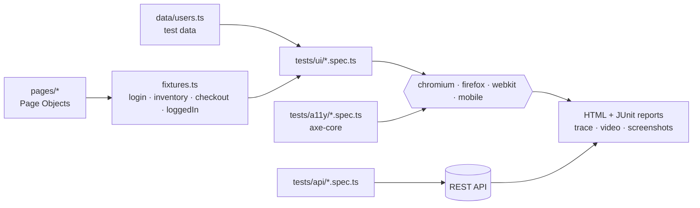
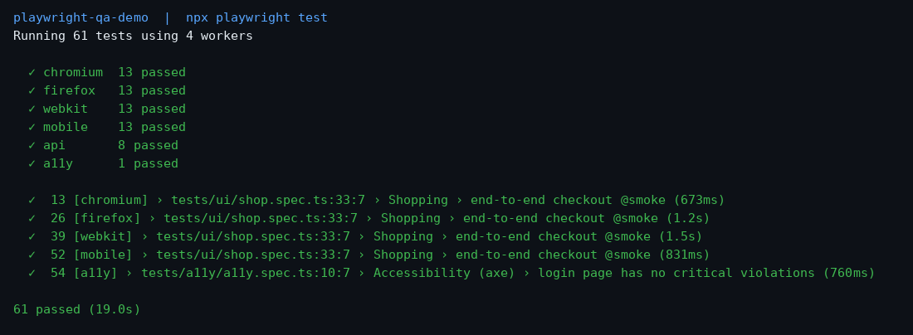

# Playwright QA Automation Demo (TypeScript)

[](https://github.com/lrm22221-afk/playwright-qa-demo/actions/workflows/playwright.yml)


A portfolio test suite showing how I structure maintainable end-to-end automation:
UI tests on [SauceDemo](https://www.saucedemo.com) and REST API tests on [JSONPlaceholder](https://jsonplaceholder.typicode.com).

## What it demonstrates

- **Page Object Model** (`pages/`) with typed locators based on `data-test` attributes
- **Custom fixtures** (`tests/ui/fixtures.ts`) incl. a `loggedIn` fixture that starts tests authenticated
- **Data-driven tests** – negative login cases and sort orders come from `data/users.ts`
- **Cross-browser + mobile** – Chromium, Firefox, WebKit and Pixel 7 emulation
- **API testing** – GET/POST/PUT/DELETE, status codes, headers, type-guard schema check, parametrized queries
- **Accessibility** – axe-core WCAG 2.1 AA scan, gates on critical issues, full report attached
- **Debuggability** – retries on CI, trace on first retry, screenshot + video on failure
- **Reports** – HTML report + JUnit XML (for CI dashboards)
- **Code quality** – strict TypeScript, ESLint (`typescript-eslint`, `eslint-plugin-playwright`), Prettier
- **CI** – GitHub Actions workflow: lint job, then a matrix job per browser/project, report artifacts (see `.github/workflows/playwright.yml`)

## Architecture



```
pages/        Page Objects (Login, Inventory, Checkout)
data/         Test data tables for data-driven tests
tests/ui/     UI specs + fixtures (run on 4 browser projects)
tests/api/    API specs
tests/a11y/   Accessibility specs
ci/           GitHub Actions workflow
```

## How to run

```bash
npm ci
npx playwright install --with-deps
npm test                 # everything (61 tests)
npm run test:chromium    # chromium UI + API + a11y only
npm run test:smoke       # @smoke tagged tests
npm run test:api
npm run report           # open the HTML report
npm run lint && npm run typecheck && npm run format:check
```

Base URLs can be overridden with `UI_BASE_URL` / `API_BASE_URL`.

## Result

Latest local run: **61 passed** across 6 projects (chromium, firefox, webkit, mobile, a11y, api).



## CI note

GitHub Actions workflow: `.github/workflows/playwright.yml`.

---

Author: Liram Mor – QA Automation Engineer
